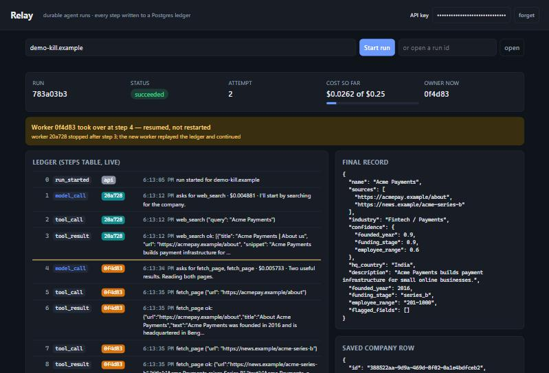
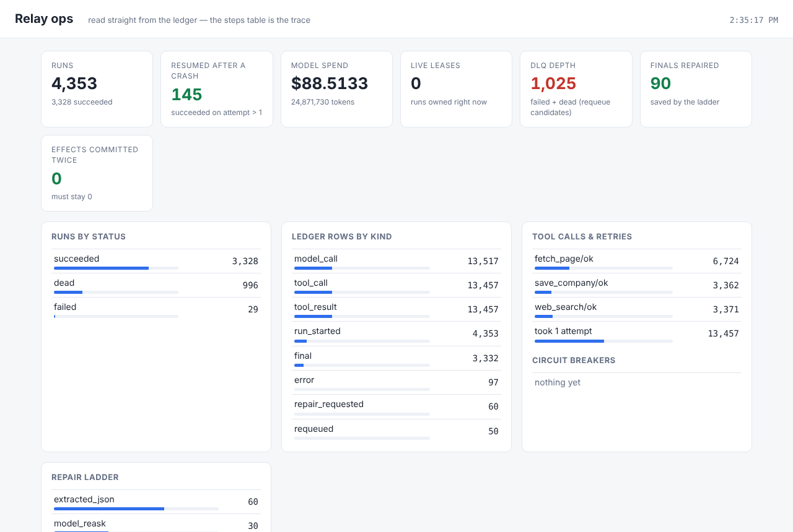

# Relay

**A durable execution runtime for LLM agents.**

An agent run must survive the worker process being killed at any moment, resume from the last completed step, and never duplicate a side effect.

Instead of an agent loop living in a process that dies when the process dies, every model call and every tool invocation is appended to a write-ahead ledger in PostgreSQL. If a worker crashes, is deployed over, or hits a rate limit, another worker picks the run up and continues from the exact step where it stopped — without re-issuing model calls already paid for, and without re-executing side effects already applied.



*The demo page during run `783a03b3`: the worker that owned the run was killed with `docker kill` after step 3; another worker replayed the ledger and continued at step 4.*



*The `/ops` page over this repo's own test history — 4,300+ runs of chaos/fencing/repair harnesses: 145 crash-resumes, the repair ladder's rungs, and `effects committed twice: 0`. Every number is aggregated from the `steps` table at request time; the same data ships as Prometheus metrics at `/metrics`.*

---

## Status

**Under active development.** This section is updated at the end of every working day.

| Area | State |
|---|---|
| Ledger, leases, fencing, crash recovery | ✅ working, manually verified (evidence below) |
| Worker pool, `SKIP LOCKED` claiming | ✅ working, 3 workers |
| LLM client layer, output schemas, cost accounting | ✅ working, against a scripted fake model |
| Tools (`web_search`, `fetch_page` on canned fake data; `lookup_existing`, `save_company`, `flag_for_review` on Postgres), tool registry, system prompt | ✅ working |
| Agent loop inside the workers | ✅ runs end to end: request → worker → ledger → stored record |
| Transcript replay after a crash | ✅ working, verified with `docker kill` mid-run (evidence below) |
| Idempotent write tools (per-tool key + unique constraint) | ✅ working, verified with `docker kill` inside `save_company` (evidence below) |
| Client `Idempotency-Key` on `POST /v1/runs` | ✅ working, 7 tests incl. 8 racing retries → 1 run (evidence below) |
| API key check, per-run budget cap | ✅ working (evidence below) |
| Full API keys (prefix + bcrypt, 60 s verification cache), tenant scoping in a repository layer, per-tenant rate limit + concurrency cap | ✅ tested live + 7 tests (evidence below) |
| Live demo page (`GET /`, pushed via SSE since Day 11, polling as fallback) | ✅ working, kill-and-resume shown live (screenshot above) |
| SSRF guard on `fetch_page` (https only, resolved IPs must be public, redirects re-checked, max 3) | ✅ unit-tested (24 cases); applied with live DNS by the real fetcher |
| Real tools behind `TOOLS_PROVIDER=real`: Tavily search + a pinned-IP page fetcher (closes DNS rebinding; 2 MB / 10 s / identity-encoding caps) | ✅ built, 32 tests with stub DNS/HTTP and a local TLS server; first real call pending a key (details: [`learn/REAL_TOOLS.md`](learn/REAL_TOOLS.md)) |
| Retries with jittered backoff + per-tool circuit breaker (shared state in Postgres) | ✅ unit-tested (21 cases) + fault-injection runs (results below) |
| Chaos harness and measured results | ✅ 200 runs (results below) |
| Idempotency / fencing / throughput test suites (blueprint §13 A2–A4) | ✅ measured (results below) + 15 new tests |
| Schema repair ladder (free JSON extraction → one model re-ask) | ✅ measured: 75/75 repairable broken finals saved (results below) |
| Prometheus `/metrics` + `/ops` dashboard compiled from the ledger; OTel traces with `steps.trace_id` | ✅ working (screenshot above), 5 tests |
| SSE for the demo page (LISTEN/NOTIFY push, fetch-streaming, polling fallback) | ✅ median 3.7 ms push latency, browser-tested, 5 tests |
| Dead-letter queue (reaper for exhausted runs, `requeued` ledger marker, operator CLI) | ✅ measured: requeued runs resume from their ledger, 0 restarts (results below) |
| Real model provider | 🔨 next (everything so far runs on a scripted fake model) |
| Public deployment | ⬜ planned |

---

## Measured results

`python -m chaos.crash_test --n 200`: each iteration starts a run, waits a random 0–10 s, runs `docker kill` on the container that owns the run, waits for the run to finish, and checks its ledger. The runs go one at a time.

| Metric | Result |
|---|---|
| Runs | 200 |
| Killed mid-run | 196 (the other 4 weren't claimed yet at the kill moment, so nothing was killed) |
| Killed runs that still finished `succeeded` | **196 / 196** |
| Model calls paid twice | **0** |
| Duplicate company rows | **0** |
| Write-tool effects committed more than once | **0** (13 `save_company` calls were re-issued after a kill and executed once) |
| Ledger rows replayed instead of redone | 1,212 (including 302 model calls not paid again) |
| Tool calls re-run after a kill landed mid-tool | 30 |
| Tokens a cold restart would have spent again | 492,938 of 1,440,982 in the killed runs (34%) |
| Time from kill to the next worker's first step | median 15.8 s, p90 16.9 s |

**Conditions:** a scripted fake model and fake search/fetch tools, with real PostgreSQL writes (Neon). 3 worker containers, a 15 s lease, and a 1.5 s fake model delay. The harness measures crash recovery, not answer quality, so it runs on the fake client. Time to resume tracks the lease setting; with the default 90 s lease it would be up to 90 s. Raw per-run data: [`chaos/iterations.jsonl`](chaos/iterations.jsonl); summary: [`chaos/results.json`](chaos/results.json); method and caveats: [`learn/CHAOS.md`](learn/CHAOS.md).

`python -m chaos.fault_test --scenario flaky --n 50` and `--scenario outage` (Day 8): the fake external tools are made to fail like the real internet does, and the run is measured instead of trusted.

| Metric | Result |
|---|---|
| Runs with 30% tool failures + 10% model failures injected | **50 / 50 succeeded** |
| Tool calls that failed, were retried, and recovered | 41 of 200 |
| Tool calls that exhausted all 3 attempts (the model is told and adapts) | 7 |
| Model calls retried | 12 |
| Ledger anomalies (index gaps, repeated model calls) | **0** |
| Outage test: `fetch_page` fully down — breaker opened after | 5 consecutive failures (the threshold) |
| Calls skipped while open, instead of hammering a dead tool | 13 |
| Breaker recovery after the outage ended | closed itself via one probe |

**Conditions:** fake model and tools with injected 503s, 3 workers, retries capped at 3 attempts with full-jitter backoff. These runs were executed against a local PostgreSQL 16 (in a development container, not Neon); the chaos-harness numbers above were measured on Neon. A worker killed with `kill -9` while retries were active (run `28ca2373`) was resumed by a second worker with no gaps and no repeated model calls. Raw numbers: [`chaos/fault_results.json`](chaos/fault_results.json); method: [`learn/DAY8.md`](learn/DAY8.md).

`python -m chaos.idempotency_test`, `python -m chaos.fencing_test --n 100`, `python -m chaos.throughput_test` (Day 16): the three safety mechanisms, leaned on far harder than real traffic would.

| Metric | Result |
|---|---|
| **A2 idempotency** — 300 keys × 4 processes racing the same `save_company` key (then again with the write window held open 20 ms, forcing full overlap), plus 200 writers `kill -9`'d mid-transaction | **500 / 500 keys executed exactly once**; 0 duplicate company rows; the write and its receipt never disagreed (they commit together); all racers got the same answer |
| **A3 fencing** — the run's owner frozen with `SIGSTOP` at a random moment, another worker takes over, the zombie woken 0–2 s later; 100 iterations | 97 frozen mid-run, **97 / 97 succeeded, 0 finished by a stale worker**; stopped by the unique constraint ×81, the heartbeat ×14, the guarded finish ×2; in 16 runs the zombie's write landed first and the *new owner* was fenced — ledgers all valid either way |
| A3 liveness note | 2 freezes landed inside a transaction, so the held row lock delayed takeover until wake-up (`SKIP LOCKED` skips locked rows); nothing duplicated — bounded in production by `idle_in_transaction_session_timeout` |
| **A4 claim query** with 100,000 finished runs in the table | **0.111 ms** with the partial index; **8.4 ms** with it dropped (~76×) — finished runs are invisible to `runs_claimable_idx` |
| **A4 throughput** at 0.2 s fake model latency | 1 → 16 workers: 1.18 → **18.4 runs/s (15.6×, 98% scaling efficiency)** on 4 CPUs — workers wait on the model, not the queue |
| A4 throughput at 0 s latency (Relay's own overhead) | 37 runs/s on 1 worker; tops out ~179 runs/s at 8 workers on 4 CPUs |
| Across all 2,430 sweep runs | 0 claimed twice, 0 ledger problems, all succeeded |

**Conditions:** local PostgreSQL 16 in a cloud development container (not Neon), 4 CPUs, workers as plain processes (no Docker). `scripts/check_run.py` now also validates ledger *shape* (starts with `run_started`, every tool row answers the latest model call, nothing after the verdict). Raw numbers: [`chaos/idempotency_results.json`](chaos/idempotency_results.json), [`chaos/fencing_results.json`](chaos/fencing_results.json), [`chaos/throughput_results.json`](chaos/throughput_results.json); method: [`learn/DAY16.md`](learn/DAY16.md).

`python -m chaos.repair_dlq_test --n 25 --exhausted-n 5` (Day 9): the repair ladder and the dead-letter queue, measured.

| Metric | Result |
|---|---|
| Broken final answers a strict parser would have failed | 100 (25 each: code-fenced, prose-wrapped, invalid value, hopeless) |
| Saved by the ladder | **75 / 75 of the repairable ones** — fenced + prose fixed free by JSON extraction, invalid values by exactly one re-asked model call each |
| Repairs performed on clean runs | **0** of 25 (the ladder never fires for nothing) |
| Hopeless answers | 25/25 failed honestly after exactly one re-ask — the ladder never loops |
| Model 90% down → `model_unavailable` failures requeued via the DLQ | 24/24 requeued, then **25/25 succeeded**; every one **resumed from its ledger** (0 restarts), keeping the model calls paid before the outage |
| Runs whose worker was `kill -9`'d on all 5 attempts | **5/5 swept to `dead` by the reaper**, requeued with a raised attempt ceiling, then succeeded |
| Ledger problems across all 155 runs | **0** |

**Conditions:** fake model/tools with injected breakage (`FAKE_BROKEN_FINAL`, `FAKE_MODEL_FAILURE_RATE`), local PostgreSQL 16 in a cloud container (not Neon), 3 process workers. Raw numbers: [`chaos/repair_dlq_results.json`](chaos/repair_dlq_results.json); method: [`learn/DAY9.md`](learn/DAY9.md).

No accuracy numbers are published yet. They need a real model and a hand-labelled dataset.

---

## The reference workload

Relay ships with one concrete agent so it is a product, not a library: a **company enrichment agent**.

Give it a company domain. It researches the company across the web, extracts a structured record, checks for duplicates, writes the record, and flags ambiguous fields for human review rather than guessing.

```
POST /v1/runs  { "domain": "razorpay.com" }
      ↓
{ "name": "Razorpay", "hq_country": "India", "founded_year": 2014,
  "industry": "Fintech / Payments", "employee_range": "1001-5000",
  "sources": ["https://..."], "flagged_fields": ["employee_range"] }
```

The workload was chosen because it is multi-step (8–15 tool calls, so there is real work to lose), long enough that crashing mid-run is realistic, dependent on genuinely flaky external calls, and — critically — because it **writes records**, which is what makes idempotency a requirement rather than a decoration.

---

## Architecture

```
  client
    │  POST /v1/runs
    ▼
┌──────────────────────┐
│ API (FastAPI)        │  auth, validation, ONE transaction, 202 Accepted
│ never calls a model  │
└──────────┬───────────┘
           │ writes
           ▼
┌──────────────────────┐        ┌────────────────────────┐
│ PostgreSQL           │        │ Worker pool (×3)       │
│  runs   ← the queue  │◄───────│  claim (SKIP LOCKED    │
│  steps  ← the ledger │  claim │         + 90s lease)   │
│  companies, approvals│        │  replay ledger         │
└──────────────────────┘        │  agent loop            │
           ▲                    │  append step, heartbeat│
           └────────────────────┴────────────────────────┘
                                          │
                                          ▼
                              model provider · web search · page fetch
```

### Three decisions that shape everything

**1. The API never calls a model.** The API tier does auth, validation, one database transaction, and returns. p99 API latency is a database write, the API can be rate-limited independently of model spend, and a model outage cannot take down the API.

**2. The queue lives inside PostgreSQL.** Enqueueing a run and creating the run row happen in the same transaction, so there is no dual-write problem, no "message published but row not committed" failure mode, and no broker to operate. `SELECT … FOR UPDATE SKIP LOCKED` is exactly the row-claiming primitive a job queue needs.

**3. The ledger is four things at once.** The `steps` table is the durable execution log, the event stream, the observability trace, and the eval trace. One append-only table serving four purposes is why the system is small.

### The four mechanisms

| Mechanism | What it does |
|---|---|
| **Lease** | A claim on a run expires after 90 seconds unless the worker renews it. A dead worker needs no cleanup: the timestamp simply passes and the same query that claims fresh runs reclaims it. |
| **Fencing** | `UNIQUE (run_id, step_index)` on the ledger. A stalled worker that wakes after its lease expired and tries to write a step the new owner already wrote gets a unique violation, recognises it was fenced, and aborts. Split-brain protection from a database constraint instead of a distributed lock service. |
| **Idempotency** | Three overlapping layers, all built: a client `Idempotency-Key` on `POST /v1/runs` (committed in the same transaction as the run it created), a per-tool-invocation key written *before* execution, and a database uniqueness constraint on the output table. The key is `<run_id>:<tool_call_id>`, so a re-run after a crash reuses it, and the write commits in the same transaction as the key's "done" mark. |
| **Replay** | A new worker rebuilds the conversation by reading the ledger in order. Not code re-execution — the transcript was written down, so recovery is a `SELECT … ORDER BY` and a loop. |

### The agent loop

The loop is the only thing that talks to both the model and the tools; they never talk to each other. Each turn it renews the lease, asks the model, and **writes the `model_call` step (with its cost) before judging the reply**, because the provider has already billed for it. For every tool the model requests, it writes a `tool_call` step *before* running the tool and a `tool_result` step after, so a crash between the two leaves a visible "started, not confirmed" marker instead of silence. A run ends with a validated record (`final`), a rejected answer or a 15-turn cap (`error`), or a lost lease, which hands the run back to the pool.

Before its first turn, the loop **replays the ledger**: one ordered `SELECT` over the run's steps rebuilds the conversation and gives the next free step index. A resumed run carries on from there. Tool calls that were logged but never confirmed are re-run before the model is asked anything, a run whose `final` or `error` is already written is not re-run, and the 15-turn cap counts turns already in the ledger.

The worker around it only claims, heartbeats and finishes. It records the outcome with an UPDATE guarded by `lease_owner = me AND status = 'running'`: a heartbeat only proves ownership at the moment it ran, so the finishing write re-checks ownership in the same statement. A worker whose lease was taken over while it was finishing cannot mark someone else's run as done.

---

## Verified so far

Manual tests against three worker containers and PostgreSQL on Neon. Run ids are from the project's own ledger.

**Agent loop end to end** — run `55d5c198`: `POST /v1/runs` → worker-2 claimed it at attempt 1 → 11 ledger rows, indexes 0–10, no gaps (`run_started`, three `model_call` turns, three `tool_call`/`tool_result` pairs including two tool calls requested in a single model reply, `final`) → run `succeeded` with the validated company record stored. Against the fake model and fake tools.

**Replay after a crash, mid-run** — run `7b0200c8`: worker-2 wrote steps 1–3 (the first model call and its search), then `docker kill`. Worker-3 claimed the run at attempt 2 once the 15 s test lease expired, rebuilt the conversation from the ledger, and wrote step 4: the *second* model reply, not the first one again. The run finished with exactly 3 `model_call` rows, the same as a run that never crashed, 11 rows 0–10, no gaps. Nothing was paid for twice.

**Replay after a crash, mid-tool** — run `efbc7f52`: worker-2 was killed after writing a `fetch_page` `tool_call` (step 5) and before its result, using a temporary 3 s delay in the fake fetch that isn't in the code. Worker-1 resumed, saw a tool call with no result, and re-ran it *before* asking the model anything: a new `tool_call` for the same call id at step 6, the result at step 7, then the remaining fetch. 3 `model_call` rows, 12 rows, no gaps. Re-running is safe here because both fetch tools only read. The next two runs show the write case.

**Exactly one company row after a crash inside `save_company`** — run `bf7b65a7`: worker-2 saved the company (the row and its `tool_invocations` receipt committed together at 11:58:46) and was killed before logging the `tool_result`. Worker-1 resumed, re-issued the same call with the same idempotency key, found the receipt marked done, and returned the stored result without writing. `SELECT count(*) FROM companies WHERE domain = …` = 1, the row was never updated, and the receipt shows `attempts = 2, executions = 1`.

**Crash before the write committed** — run `fa4340ca`: worker-2 recorded the key and was killed before its write. Worker-1 re-ran the call and did the write once. Again 1 row, `attempts = 2, executions = 1`. Both runs used temporary delays inside the tool to aim the kill; those delays aren't in the code.

**Days 8–17 re-checked on Neon and Docker** (28 Oct, Windows host): migrations 003–007 applied to Neon, the full test suite passes against it (117 tests). Normal run `fd340fcd`: 14 rows, 4 `model_call`, no gaps. Run `237c86e0`: its worker was `docker kill`ed during a `fetch_page` after 4 rows; another container re-ran that tool, attempt 2, 15 rows, still 4 `model_call`, `check_run` OK. A small Day 16 race (30 keys × 4 racing processes) and a 10-run Day 8 flaky-tools run on Neon: 0 keys executed twice, 10/10 runs succeeded. The Day 16/9 numbers in the tables above stay labelled as measured on local PostgreSQL; these smaller Neon runs only confirm the same behaviour there.

`scripts/idempotency_smoke.py` exercises the same paths without workers: the same key twice is executed once, a second key for the same domain updates the one existing row, and a key left `in_flight` by a dead worker executes exactly once.

**Client Idempotency-Key** — run `4f186a0d`: a `POST /v1/runs` sent twice with the same `Idempotency-Key` returned the same run id both times (the second with `Idempotent-Replayed: true`), the same key with a different domain got `422`, and the database held exactly one run. The key row commits in the same transaction as the run; 8 parallel retries with one key create exactly one run, and a replay is never refused by the concurrency cap (`tests/test_idempotency_key.py`, method: [`learn/IDEMPOTENCY_KEY.md`](learn/IDEMPOTENCY_KEY.md)).

**API key** — every `/v1` route requires `Authorization: Bearer <key>`, compared in constant time. Without a key, with a wrong key, or without the `Bearer` scheme: `401`. With the key: `202`. `/healthz` stays open. If the server has no key configured, `/v1` answers `503` instead of running open.

**Full API keys + tenancy (Day 10)** — keys are `rly_<prefix>.<secret>`: indexed prefix lookup in `api_keys`, bcrypt check of the secret, and the caller becomes a tenant whose id scopes every query (a repository layer makes the tenant id a required argument). Verified keys are cached 60 s as SHA-256 digests — measured live: first request 294 ms (bcrypt), second 7 ms. The single env key still works and maps to the dev tenant. Another tenant's run answers `404`, not `403`. Per-tenant limits (migration 005): requests/minute → `429` with Retry-After, and a max on concurrent runs enforced in Postgres under a per-tenant advisory lock — 8 racing creates against a cap of 3 produced exactly 3 runs (`tests/test_api_auth_tenancy.py`). Method and trade-offs (revocation lag, in-process rate window): [`learn/DAY10.md`](learn/DAY10.md).

**Per-run budget** — run `e8280abe`, created with a budget of $0.0001 (below the cost of one fake model call, $0.004881): the first model call ran, the next turn's check wrote a `budget_exceeded` step, and the run ended `failed` with exactly one `model_call` in its ledger. Spend is summed from the ledger's `model_call` rows, so the cap survives crashes and replays; it can overshoot by at most one call, whose cost is only known after it returns. A normal run (`272f1414`) costs $0.026 in fake prices against the default $0.25.

**Live demo page** — run `783a03b3`, started from the page at `GET /`: worker `20a728` wrote steps 1–3, was killed with the `docker kill` command the page displays, and worker `0f4d83` took over at step 4 (attempt 2). The page showed the takeover banner, the per-worker badges, the final record and the saved company row. The page is one static HTML file polling `GET /v1/runs/{id}` and `GET /v1/runs/{id}/steps` once a second; it holds no API key and renders ledger text as plain text only.

**SSE push (Day 11)** — a trigger rings `pg_notify` on every ledger commit (migration 006; commit-transactional, so a fenced zombie's rolled-back insert rings nothing), and `GET /v1/runs/{id}/events` streams `update` events re-read through the tenant-scoped repository. The page consumes it with fetch-streaming (EventSource can't send the Authorization header) and falls back to the old polling automatically. Measured over 5 live worker runs: 65 steps pushed at **median 3.7 ms / p90 6.7 ms** from insert commit to parsed client event (local Postgres; polling at 1 s averaged ~500 ms). Browser-verified with Playwright: a full run streamed with zero console errors. Method: [`learn/DAY11.md`](learn/DAY11.md).

`scripts/check_run.py` checks every run above for index gaps and repeated model calls. The "already finished" and "already failed" replay paths are covered by unit tests (`tests/test_replay.py`) but haven't been hit live.

**Crash recovery (placeholder workload, before the agent loop)** — run `01ab701a`: worker-3 wrote steps 1–5, then `docker kill` (exit 137). Worker-1 claimed the run at attempt 2 once the lease expired, resumed at step 6, and finished. Ledger 0–6, no gaps, no repeated steps.

**Fencing under a simulated stall** — run `e9bcda30`: worker-1 wrote steps 1–2, then `docker pause`. Worker-3 claimed the run 18s later at attempt 2 and wrote steps 3–6. On `docker unpause`, worker-1 attempted step 3, hit the unique constraint, logged `lease_lost`, wrote nothing further, and stayed healthy.

**Claim exclusivity**: 50 runs drained by 3 workers — every run processed exactly once, no run with two distinct lease owners.

All of these were run by hand, one run at a time, against the fake model and fake tools. The `01ab701a` and `e9bcda30` tests predate the agent loop. The 200-run chaos harness (see Measured results) repeats the kill test with random kill points.

---

## Deliberately excluded

| Not used | Why |
|---|---|
| Kubernetes | One service, three worker processes, one box. |
| Kafka | One producer, one consumer group; the ledger already provides replay. |
| Celery / RQ | They would hide the exact mechanism this project exists to demonstrate. |
| LangChain / LangGraph | The loop is the deliverable; a framework would obscure it. |
| Vector database | There is no corpus. Retrieval is live web search. |
| React | The UI is a form and a log tail. |

Relay is also **not a Temporal clone**. It is a deliberately minimal, Postgres-only subset of durable execution. Temporal replays your *code*, and therefore has to handle non-determinism and sandboxing; Relay replays the *transcript*, which is far simpler and gives up the ability to resume mid-model-call.

---

## Stack

Python 3.13 · FastAPI · Pydantic v2 · psycopg 3 (raw SQL, no ORM) · Alembic · PostgreSQL (Neon) · Docker Compose · prometheus-client · OpenTelemetry SDK

Planned: Grafana + an OTLP collector (the config file is in the repo), Caddy, AWS EC2. Redis stays out until a measured need appears.

**On model spend:** development runs against a scripted fake model client and fake tools (canned search results and pages) behind the same `LLMClient` interface a real provider will use, so durability work costs nothing to test. The fake is deterministic and chooses its reply from the conversation it is handed rather than from internal state — meaning a fresh worker resuming after a crash gets the same reply the dead one would have. The chaos harness ran on the fake client, because it measures crash recovery rather than model quality; this is stated next to the numbers.

---

## Roadmap

Currently implements durable execution, lease-based claiming with fencing, transcript replay, tool-level idempotency with a database backstop, full per-tenant API keys with rate and concurrency limits, a per-run budget, a repair ladder and dead-letter queue, a live demo page, and measured chaos-harness results.

Next, in order: the switch from the fake model to a real provider (with real search and page fetch); public deployment; then a hand-labelled golden dataset with LLM-as-judge evaluation gated in CI.

Per-tool circuit breakers and retry-with-backoff landed with Day 8, the idempotency / fencing / throughput test suites with Day 16, the schema repair ladder + dead-letter queue with Day 9, and Prometheus metrics + OpenTelemetry tracing + the `/ops` dashboard with Day 17. The ladder's last rung — escalating to a *stronger* model — waits for the real-model switch; Grafana and the OTLP collector come with deployment.
